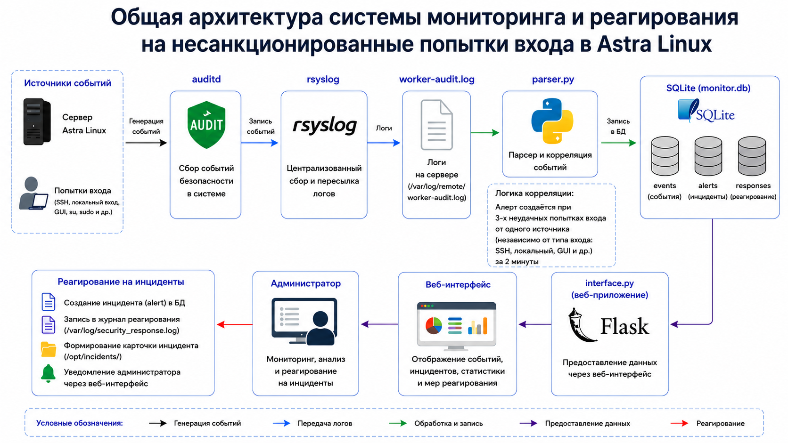

# Система мониторинга и реагирования на несанкционированные попытке входа в Astra linux

Данный проект представляет собой систему мониторинга предназначенную для обнаружения и регистрации подозрительных попыток аутентификации. Основной задачей системы является обнаружение потенциально несанкционированного доступа с формированием оповещений.
В проекте использовались: Astra Linux 1.8.5, auditd, rsyslog, Python, Flask, SQLite, HTML

### Основные возможности системы:

- Обнаружение неудачных попыток входа 
- Формирование алерта при трех неудачных попытках авторизации одного пользователя за короткий промежуток времени
- Отображение событий и алертов в графическом интерфейсе
- Хранение информаии о событиях для последующего анализа

### Архитектура системы:

1. Наблюдаема машина(далее рабочая машина).
На ней происходит сбор событий при помощи auditd, правила для которого указаны в audit.rules, и передача журналов на сервер администрирования при помощи rsyslog.

2. Cервер администрирования(далее админская машина).
Принимает журналы через rsyslog, сохраняет их в отдельный файл и дальше передает в Python-парсер который хостится на этой же машине.

3. Веб-интерфейс - Flask-приложение обращающеся к базе SQLite отображающее события, статистику и обнаруженные инциденты


### Структура проекта

monitoring-auth-astra-linux/
├── parser/
│   └── parser.py
├── web/
│   ├── interface.py
│   └── templates/
│       └── index.html
├── config/
│   ├── worker/
│   │   └── 10-audit-forward.conf
│   ├── admin/
│   │   └── 10-remote.conf
│   └── audit.rules
├── docs/
│   ├── scheme_of_system.png
├── requirements.txt
└── README.md

### Установка

1. Клонирование репозитория.
```bash
git clone https://github.com/reflex-surface/monitoring_system.git
```
2. Установка зависимостей.
```bash
python3 -m venv venv
source venv/bin/activate
pip install -r requirements.txt
```
3. Настройка компонентов.
Конфиги и правила помещаются в следующие директории:
рабочая машина:
10-audit-forward.conf -> /etc/rsyslog.d/
audit.rules -> /etc/audit/
админская машина:
10-remote-conf -> /etc/rsyslog.d
В файлах конфигов корректно указать IP-адреса.
Настроить путь к файлу журнала, который будет обрабатывать парсер;
Убедиться, что у процессов есть необходимые права на чтение журналов и запись в базу данных.
4. Запуск парсера
```bash
python3 parser/parser.py
```
5. Запуск веб-интерфейса
```bash
python3 web/interface.py
```
После запуска веб-интерфейс будет доступен по адресу:
http://localhost:5000
В текущей реализации путь к базе данных - /opt/monitor.db, это можно изменить в файлах parser.py и interface.py

### Ограничения текущей реализации
- Обнаружение brute-force основано на количестве неудачных событий с одного IP-адреса, а не на последовательности попыток для конкретной учётной записи.
- Система формирует оповещения и карточки инцидентов, но не выполняет автоматическую блокировку IP-адресов.
- Отправка уведомлений по электронной почте или через внешние системы не реализована.
- Перед использованием в рабочей инфраструктуре необходимо проверить настройки доступа, сетевые параметры и права на файлы.

### Дальнейшее развитие

- Развертывание с помощью Vagrant;

Проект разработан в учебно-практических целях для изучения
механизмов аудита Astra Linux, централизованного сбора журналов,
анализа событий информационной безопасности и обнаружения
подозрительной активности.
